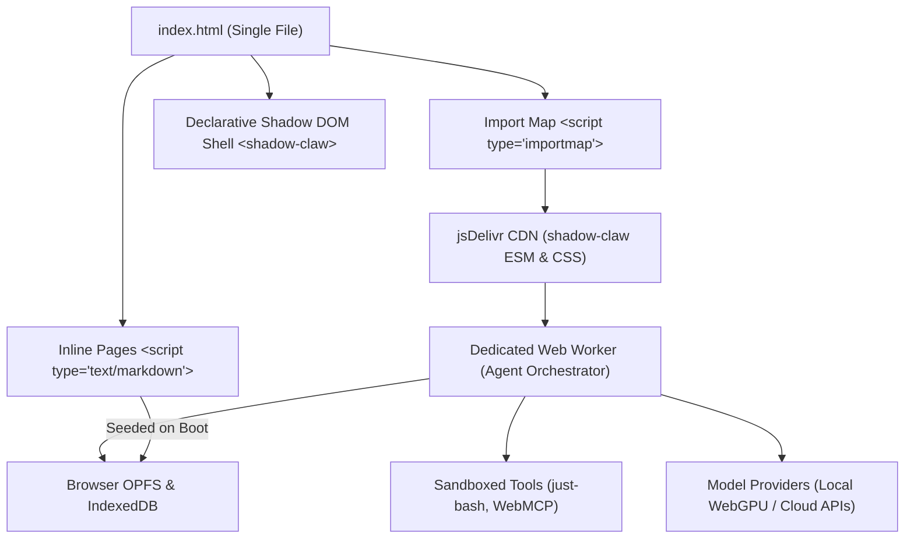

# 🦞 [ShadowClaw Single File](https://xt-ml.github.io/shadow-claw-single-file/)

[](https://github.com/xt-ml/shadow-claw)
[](https://www.npmjs.com/package/shadow-claw)
[](index.html)
[](https://github.com/xt-ml/shadow-claw/blob/main/LICENSE)

**ShadowClaw Single File** is a zero-install, zero-build, standalone single-file distribution of [ShadowClaw](https://github.com/xt-ml/shadow-claw) — the multi-runtime AI assistant.

It encapsulates the complete browser-native AI assistant client within a single [`index.html`](file:///packages/xt-ml/shadow-claw-single-file/index.html) document. By leveraging browser-native [Import Maps](https://developer.mozilla.org/en-US/docs/Web/HTML/Element/script/type/importmap), modern Web Standards, and CDN-delivered modular ESM packages, it delivers the full power of ShadowClaw without requiring local compilation, bundling tools, or asset directories.

---

## 🌟 Highlights

- **Single-File Footprint:** The entire user interface, runtime bootstrap, static pages, and memory scratchpads reside inside a standalone [`index.html`](file:///packages/xt-ml/shadow-claw-single-file/index.html).
- **Zero Build to Run:** Open the file through any local or remote HTTP server; no bundler or pre-compiler needed for runtime operation.
- **CDN-Backed Modular ESM Runtime:** Uses `<script type="importmap">` to resolve the core ShadowClaw web component library (`shadow-claw`) and assets directly from jsDelivr.
- **Off-Main-Thread Orchestrator:** The reasoning state machine, tool invocation pipeline, and context-window management execute off the main thread inside a dedicated Web Worker.
- **Local Sandbox & Privacy First:** Sandboxed virtual filesystem storage via the browser's Origin Private File System (OPFS) and IndexedDB.
- **Flexible LLM Execution:**
  - **In-Browser Local AI:** Execute models directly in the browser via [Transformers.js](https://huggingface.co/docs/transformers.js) (ONNX runtime with WebGPU / WASM acceleration) or Chrome's native Built-in AI Prompt API (`window.LanguageModel`).
  - **Cloud Providers:** Connect directly to OpenRouter, Anthropic, OpenAI, Google Gemini, AWS Bedrock, or custom local OpenAI-compatible endpoints (such as Ollama or Llamafile).
- **Built-in Shell & Tools:** In-browser POSIX shell emulator powered by `just-bash`, declarative tool invocation, and [WebMCP](https://github.com/xt-ml/shadow-claw/blob/main/docs/subsystems/webmcp.md) (`document.modelContext`) discovery.
- **Deploy Anywhere:** Ready to host on GitHub Pages, Cloudflare Pages, Netlify, AWS S3 / Cloudflare R2, or internal intranets.

---

## 🚀 Quick Start

### 1. Run Locally

Clone the repository and serve the current directory:

```bash
# Clone the repository
git clone https://github.com/xt-ml/shadow-claw-single-file.git
cd shadow-claw-single-file

# Install minimal dev dependency (serve)
npm install

# Start local static server
npm start
```

Or run directly using any static HTTP file server:

```bash
# Using npx serve
npx serve -s .

# Or using Python 3
python3 -m http.server 8080
```

Open your browser to `http://localhost:3000` (or `http://localhost:8080`) to begin chatting and exploring your local workspace.

### 2. GitHub Pages Deployment

When hosting under a subpath on GitHub Pages (e.g. `https://<user>.github.io/shadow-claw-single-file/`), run the base URL preparation script before committing or deploying:

```bash
npm run build:base
```

This runs [`bin/build-base.mjs`](file:///packages/xt-ml/shadow-claw-single-file/bin/build-base.mjs) to update the HTML `<base href="/" />` to `<base href="/shadow-claw-single-file/" />`.

---

## 🏛️ How It Works

ShadowClaw Single File utilizes ShadowClaw's **Tier 1 / Tier 3 Standalone Architecture**:



### 1. Modular ESM Import Map

The document declares an import map pointing directly to the versioned, pre-bundled ESM release on jsDelivr:

```html
<script type="importmap">
  {
    "imports": {
      "shadow-claw": "https://cdn.jsdelivr.net/npm/shadow-claw@1.59.4/dist/lib/index.js",
      "shadow-claw/": "https://cdn.jsdelivr.net/npm/shadow-claw@1.59.4/"
    }
  }
</script>
<script type="module">
  import "shadow-claw";
</script>
```

Runtime assets (stylesheets, web worker scripts, icons, and theme files) are resolved via `<meta name="shadow-claw-asset-base">` against the CDN.

### 2. Embedded Markdown Pages (Tier 1 Seeding)

Instead of relying on multi-file server routes or HTTP directory-listing APIs, static documentation, guides, and initial memory scratchpads are embedded directly in `<head>` as inline markdown scripts:

```html
<script type="text/markdown" data-shadow-claw-page="index.html">
  ---
  title: "ShadowClaw Pages"
  slug: "shadow-claw-pages"
  ---

  # Welcome to ShadowClaw Pages
</script>

<script type="text/markdown" data-shadow-claw-page="MEMORY.md"></script>
```

On first launch, ShadowClaw's static manifest scanner (`getStaticMainManifest`) discovers these scripts and seeds them into the browser's OPFS workspace without requiring external network round-trips.

### 3. Client-Side Self-Healing & Dedenting

Standalone files include helper routines directly in [`index.html`](file:///packages/xt-ml/shadow-claw-single-file/index.html) to ensure:

- Indented markdown content from code formatters (such as Prettier) is automatically dedented.
- Stale OPFS files with leading whitespace before YAML frontmatter are self-healed on load.

---

## 🛠️ Rebuilding & Customizing

This single-file distribution is compiled using the official [ShadowClaw CLI](https://github.com/xt-ml/shadow-claw):

```bash
# Compile a workspace into a standalone single-file distribution
npx shadow-claw build --single-file

# Specify a custom CDN host
npx shadow-claw build --single-file --cdn "https://cdn.jsdelivr.net/npm/shadow-claw@1.59.4"

# Set a custom base path prefix
npx shadow-claw build --single-file --base-path "/shadow-claw-single-file/"
```

When `--single-file` is passed to `shadow-claw build`, the compiler:

1. Discovers markdown pages from `pages/main/*.md` and inlines them as `<script type="text/markdown" data-shadow-claw-page="...">` elements.
2. Discovers custom theme CSS and injects it into `<style id="shadow-claw-theme">`.
3. Resolves the runtime CDN URL and configures the `<script type="importmap">` and `<meta name="shadow-claw-asset-base">` tags.
4. Strips local build dependencies, producing a 100% self-contained HTML file.

---

## 📁 Repository Layout

```txt
shadow-claw-single-file/
├── bin/
│   └── build-base.mjs        # Helper to adjust <base href> for GitHub Pages hosting
├── 404.html                  # GitHub Pages SPA client redirect handler
├── index.html                # The standalone single-file ShadowClaw distribution (~64 KB)
├── package.json              # NPM scripts and local dev server dependency
├── package-lock.json         # Pinned dependency lockfile
└── README.md                 # Project documentation
```

---

## ⚖️ Distribution Comparison

| Feature                | ShadowClaw Single File        | [ShadowClaw Template](https://github.com/xt-ml/shadow-claw-template) | [ShadowClaw Core & CLI](https://github.com/xt-ml/shadow-claw) |
| :--------------------- | :---------------------------- | :------------------------------------------------------------------- | :------------------------------------------------------------ |
| **Artifact Structure** | 1 standalone HTML file        | Multi-file git repo with build workflow                              | Full dual-runtime package & CLI                               |
| **Build Requirement**  | None (pre-compiled)           | GitHub Actions / `npx shadow-claw build`                             | Rolldown / npm scripts                                        |
| **Asset Delivery**     | jsDelivr CDN                  | Bundled locally or self-hosted                                       | Local bundle / Express / Electron                             |
| **Interactive UI**     | Full Web Components + Signals | Full Web Components + Signals                                        | Full Web Components + Signals                                 |
| **OPFS & Storage**     | Browser OPFS + IndexedDB      | Browser OPFS + IndexedDB                                             | OPFS, IndexedDB, Node FS, SQLite                              |
| **Headless CLI Agent** | ❌ (Client-only)              | ❌ (Client-only)                                                     | ✅ `shadow-claw agent`                                        |
| **Local Host Server**  | Optional (`serve`)            | Optional (`shadow-claw dev`)                                         | ✅ `shadow-claw server` daemon                                |

---

## 🔗 Related Resources

- **Main Repository:** [xt-ml/shadow-claw](https://github.com/xt-ml/shadow-claw)
- **Live Deployment:** [ShadowClaw Web App](https://xt-ml.github.io/shadow-claw/)
- **Starter Template:** [xt-ml/shadow-claw-template](https://github.com/xt-ml/shadow-claw-template)
- **Knowledge Base:** [DeepWiki — ShadowClaw](https://deepwiki.com/xt-ml/shadow-claw)
- **Agent Skills Discovery:** [Agent Skills Discovery RFC](https://github.com/cloudflare/agent-skills-discovery-rfc)

---

## 📄 License

This project is licensed under the [GNU Affero General Public License v3.0 (AGPL-3.0)](https://github.com/xt-ml/shadow-claw/blob/main/LICENSE).
